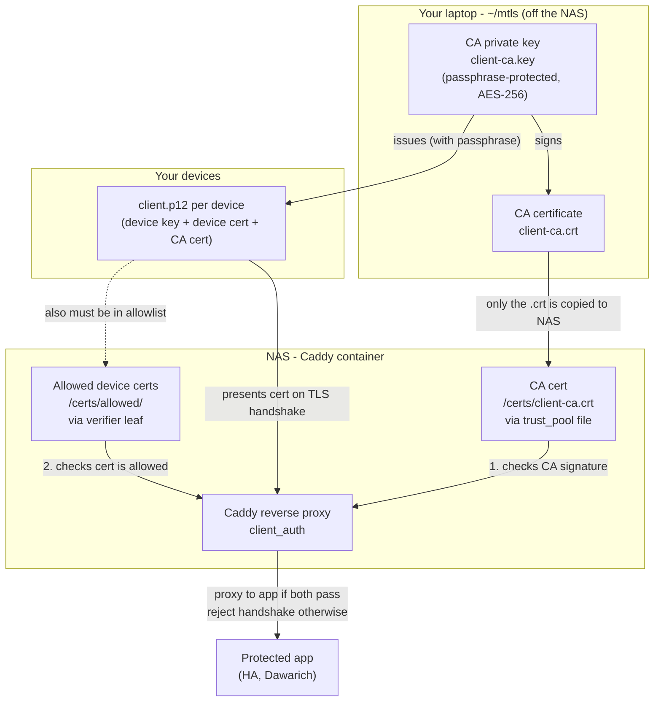

# Caddy mTLS

This file explains how mTLS (mutual TLS / client-certificate auth) works in your
Caddy setup: who holds what, and why **Caddy** and not the protected app is the
enforcement point.

## Why enforce at Caddy, not at the app

mTLS is verified at the **TLS edge**, before any HTTP request reaches the
proxied application. Caddy terminates TLS, and its `client_auth` directive
rejects the connection during the TLS handshake if the client's certificate
isn't signed by your CA.

The sequence:

1. Client connects and presents its `client.p12` certificate.
2. Caddy checks the cert's signature against the CA supplied by `trust_pool`
   (`/certs/client-ca.crt`).
3. Caddy checks the *specific* cert is in the allowlist loaded by
   `verifier leaf` from `/certs/allowed/`.
4. **Both checks pass →** Caddy proxies the request to the app.
5. **Either check fails →** Caddy aborts the handshake. The app **never sees
   the request**.

Because the check happens at the edge, the protected apps are small-re-surfaced
"internal" services: they never have to defend against unauthenticated
internet traffic, because they never receive it. This reduces the attack
surface of each app to *only* what a properly-certified client can do.

### Why that surface reduction is meaningful

Your apps (Home Assistant, Dawarich) sit behind Caddy, and Caddy is the
battle-tested, security-reviewed boundary. By making Caddy the sole gatekeeper:

- Apps don't need their own external auth hardening against anonymous traffic.
- An attacker without a valid client cert cannot reach, fingerprint, or fuzz
  the app at all.
- Even a newly-deployed app is only as exposed as Caddy lets it be.

## The pieces



## How it maps to the Caddyfile

```caddyfile
# `trust_pool` supplies the CA (implies require_and_verify). `verifier leaf`
# restricts acceptance to the specific certs present in /certs/allowed, so a
# leaked cert can be revoked by deleting its file (no CA rotation).
(client_mtls) {
    tls {
        client_auth {
            trust_pool file /certs/client-ca.crt
            verifier leaf {
                folder /certs/allowed
            }
        }
    }
}

# Import the snippet into any site block to lock it down.
YOUR_HA_DOMAIN:35000 {
    import client_mtls
    reverse_proxy YOUR_HA_VM_IP:80
}
```

The CA cert and the `allowed/` folder are mounted read-only from the host
(`/mnt/ssd-storage/apps-data/caddy/certs:/certs:ro` in `compose.yml`). Add or
remove cert files under `allowed/` on the host, then reload Caddy.

> [!IMPORTANT] Files in `allowed/` must be named `*.pem`
> The `verifier leaf { folder ... }` loader only reads files whose name ends in
> `.pem` (case-insensitive). Any other extension (`.crt`, `.cer`, ...) is
> **silently skipped**, so the cert never enters the allowlist and the device is
> rejected at the handshake with `client leaf certificate failed validation`.
> The CA (`trust_pool file /certs/client-ca.crt`) is an explicit file path, so
> its extension does not matter, only the `allowed/` folder is affected.

## The two security points

- **Private key stays off the NAS.** Only the public `client-ca.crt` crosses
  to the NAS. An attacker who takes the NAS cannot mint new client certs.
- **The laptop `~/mtls` is the single point of failure.** Lose the CA key /
  passphrase and you can't issue device certs for any new device (lockout).
  Leak it and *every* mTLS app is compromised at once.

## Caveats

- **Certs expire silently.** The CA lasts 10 years (−days 3650) and each device
  cert ~2.3 years (−days 825). On expiry the app simply stops loading with no
  warning. Set a reminder ~30 days out to re-issue.
- **Revocation is per-cert, by allowlist.** There is no CRL endpoint; instead a
  device is allowed only if its cert file (named `*.pem`) is in
  `/certs/allowed/`. To revoke a leaked cert, delete its file from the folder
  and reload. Removing it does not affect other devices. Remember to add each
  new cert (as `*.pem`) to the folder when you issue it, or the device is
  silently rejected.
- **One shared CA is a single point of failure.** All apps trust the one CA, so
  a CA-key leak compromises *all* of them at once. Protect the CA key
  accordingly (see the vault note in the repo-root README).

## Related

- Full setup, cert-creation commands, device-install steps, and the vault list
  live in `README.md` at the repo root (mTLS section under Home Assistant).
- `Caddyfile` holds the `client_mtls` snippet and the per-app `import`s.
